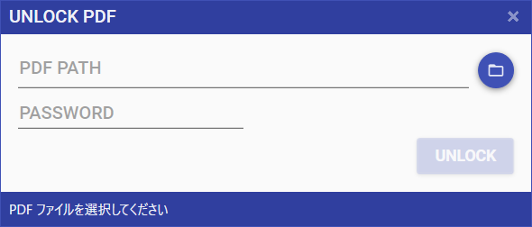

# Unlock PDF

Windows 11向けのPDFパスワード解除アプリです。閲覧権限のあるパスワード付きPDFを、ページ内容とサイズを保ったまま暗号化なしのPDFとして保存します。

> 使用する権利があるPDFだけを処理してください。



## 利用方法

1. [Releases](https://github.com/KatsuYuzu/UnlockPdf/releases)から最新版の`UnlockPdf-win-x64-v*.exe`をダウンロードします。
2. EXEを起動します。
3. PDFファイルを選択し、パスワードを入力します。
4. `UNLOCK`または`Enter`を押します。
5. 元ファイルと同じフォルダーに`<元ファイル名>_unlocked.pdf`が作成されます。

配布EXEは自己完結型のため、Windows 11に.NETや追加アプリをインストールする必要はありません。初回起動時にOSがSmartScreen警告を表示する場合があります。

## 動作要件

- Windows 11 x64
- インターネット接続は不要

## セキュリティ

- 入力PDFは端末内でのみ処理され、外部送信しません。
- 出力は完全に書き込み終えてから公開し、失敗時の一時ファイルを削除します。
- 同名ファイルがある場合は` (1)`のような番号付き名前を使用します。
- PDFファイルはGit管理対象外です。

## 技術構成

- .NET 8 LTS
- WPF
- CommunityToolkit.Mvvm 8.4.2
- MahApps.Metro 2.4.11
- MaterialDesignThemes 5.4.0
- MaterialDesignThemes.MahApps 5.4.0
- QPdfSharp 1.2.0
- QPDF Runtime 11.9.1

Livet、ReactiveProperty、iTextSharpは使用していません。MahApps.MetroとMaterial Designは.NET 8対応の現行安定版です。

## 開発

```powershell
dotnet restore UnlockPdf.sln
dotnet build UnlockPdf.sln -c Release
dotnet publish src/UnlockPdf/UnlockPdf.csproj -c Release -r win-x64 --self-contained true -o artifacts/win-x64
```

発行結果の`artifacts/win-x64/UnlockPdf.exe`が単一ファイル配布物です。

## Release手順

1. 変更を既定ブランチへ取り込みます。
2. `v2.0.0`形式のタグを作成してpushします。
3. GitHub ActionsがWindows x64向けEXEを作成してGitHub Releaseへ添付します。

詳細は[リリース手順](docs/release.md)、変更履歴は[CHANGELOG](docs/CHANGELOG.md)を参照してください。

NuGetとGitHub Actionsの依存更新はDependabotで毎週確認します。

## Release Notes 2.0.0

- .NET 8 LTSとWPFの標準機能へ移行
- Livet、ReactiveProperty、iTextSharpを削除
- MahApps.MetroとMaterial Designを現行安定版へ更新
- QPDFを使って編集権限制限付きPDFと元ページサイズを維持
- Windows x64向け自己完結型・単一EXE配布に変更
- `v*`タグpushでGitHub Releaseを作成

## License

Unlock PDFは[MIT License](LICENSE)です。依存ライブラリのライセンスは[THIRD-PARTY-NOTICES.md](THIRD-PARTY-NOTICES.md)を参照してください。
